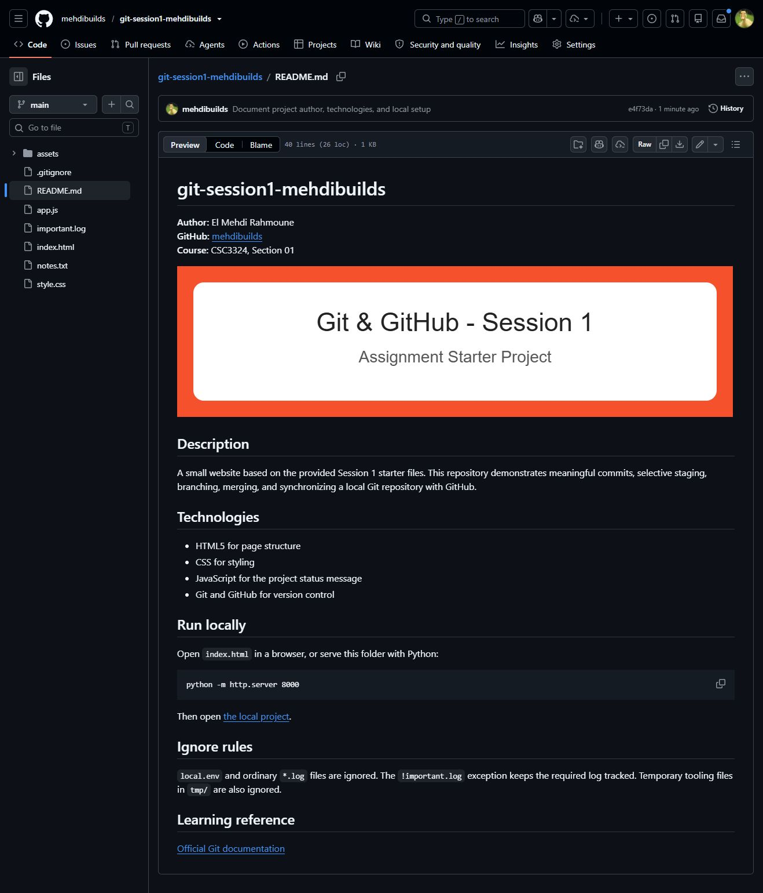

# Assignment 1 - Git & GitHub Fundamentals

Session 1 - Group A | October 12, 2026

Full Name: El Mehdi Rahmoune | Student ID: 156875

Course Code & Section: CSC3324, Section 01 | GitHub Username: mehdibuilds

Repository: https://github.com/mehdibuilds/git-session1-mehdibuilds

## 1. Repository Setup

The supplied STARTER folder was initialized with git init -b main. The project is named git-session1-mehdibuilds on GitHub. The .gitignore excludes local.env and *.log, then uses !important.log to keep the required log tracked. Temporary rendering files are also ignored.

```text
git init -b main
# .gitignore
local.env
*.log
!important.log
tmp/
__pycache__/
```

Verification: git check-ignore -v matched local.env, app.log, and debug.log; git ls-files important.log returned important.log. No ignored local configuration or routine logs were published.

Troubleshooting: Git initially reported dubious ownership because the sandbox account and the folder owner differed. Commands used a safe.directory exception for this exact workspace with git -c safe.directory="<workspace>". This was scoped to each command; no global trust setting was changed. Git writes ran with the required filesystem permission.

## 2. README & Commit History

The README includes the author, GitHub username, project description, technologies, a Python server code block, links, and the supplied SVG banner. Changes were separated into setup, README documentation, HTML content, CSS styling, and an About feature, followed by a merge and a GitHub README edit. The history below contains seven commits before the final report commit, across more than three files.

```text
git log --graph --oneline --decorate --all
* 6430218 (HEAD -> main, origin/main) Add README update from GitHub...
*   bb4fabc Merge About feature into main
|\  
| * 9e67f66 (feature/about) Add About section with author and learning goals
|/  
* 3331ee7 Improve readable spacing and responsive heading styles
* 9632ace Personalize project overview using selective staging
* e4f73da Document project author, technologies, and local setup
* 84f7595 Initialize starter project and ignore local files
```

The two long messages above are shortened for page width; evidence/commands.txt retains the complete output.

## 3. Selective Staging

index.html and style.css were edited together. Only index.html was staged and committed first (9632ace). style.css remained modified and was committed separately (3331ee7). In git status --short, the first column is the index and the second is the working tree.

```text
Before staging:
 M index.html
 M style.css

After git add index.html:
M  index.html
 M style.css

After committing index.html:
 M style.css
```

git diff showed unstaged changes to both files before staging. git diff --cached then showed only the staged HTML changes. Excerpts from the actual output are below; the full diffs are stored in evidence/commands.txt.

```text
Unstaged diff: git diff -- index.html style.css
   margin-top: 20px;
   padding: 20px;
   border: 1px solid #e3e3e3;
+  border-radius: 8px;
+}
+
+h1 {
+  font-size: clamp(1.75rem, 1.3rem + 2vw, 2.5rem);
+  line-height: 1.2;
 }
```

```text
Staged diff: git diff --cached
-    <p>Starter project for Session 1.</p>
+    <p>El Mehdi Rahmoune · CSC3324 · Section 01</p>
   </header>
   <main>
     <section id="overview">
       <h2>Project Overview</h2>
-      <p>This small project will evolve throughout the assignment.</p>
+      <p>A practical lab for commits, selective staging, branches, and GitHub synchronization.</p>
     </section>
```

## 4. Branch & Merge

The feature/about branch added an About section containing the author, course, learning goals, and GitHub profile link. After committing the feature, main was checked out and merged with --no-ff so the branch relationship remains visible in history. The merge succeeded without a conflict.

```text
git switch -c feature/about
git add index.html
git commit -m "Add About section with author and learning goals"
git switch main
git merge --no-ff feature/about -m "Merge About feature into main"
```

Feature commit: 9e67f66. Merge commit: bb4fabc, with two parents. The graph in section 2 records both paths.

## 5. Remote Changes

A commit records staged changes in the local repository. A push sends local commits to the remote repository. The empty GitHub repository was connected as origin, and git push -u origin main published main and configured its upstream.

```text
git remote add origin https://github.com/mehdibuilds/git-session1-mehdibuilds.git
git push -u origin main
```

The Remote update section was added to README.md directly in the GitHub editor and committed as 6430218. Fetch downloaded that commit and updated origin/main, without integrating it into local main. HEAD and the README SHA256 hash were compared before and after fetch; both stayed unchanged.

```text
git fetch origin
HEAD unchanged: True
README SHA256 unchanged: True
## main...origin/main [behind 1]

git rev-list --left-right --count main...origin/main
0    1

git log --oneline main..origin/main
6430218 Add README update from GitHub for fetch and pull practice
```

Pull fetches and integrates remote changes. git pull --ff-only origin main fast-forwarded main to the remote README commit. The ahead/behind counts became 0 0, and the new section appeared in the local README.

```text
Updating bb4fabc..6430218
Fast-forward
 README.md | 4 ++++
 1 file changed, 4 insertions(+)
0	0
```

## 6. Fair Use of AI

Codex AI was used to read the assignment, prepare the README and About section, execute the Git workflow, capture evidence, and draft this report. The request was "do the assignment", followed by the student identity details and authorization to publish the report. The assistant accepted the starter project structure and made small HTML and CSS edits. It checked the results against official Git documentation, actual status/diff/log output, README hashes around fetch, and a browser preview with no errors. These checks were performed by the assistant; this report does not claim that the student independently ran every command. The student must review the commands, explanations, and reflection before submission.

## 7. Sources & Reflection

Sources consulted: the provided assignment and report template; official Git manuals for gitignore (https://git-scm.com/docs/gitignore), git diff (https://git-scm.com/docs/git-diff), and git fetch (https://git-scm.com/docs/git-fetch).

Reflection draft for student review: The most subtle concept is that fetch updates origin/main while leaving local main and the working files unchanged. If Git behaves unexpectedly, first check git status, the current branch, and git remote -v; then inspect git diff and git diff --cached before committing.

## Evidence - Rendered README on GitHub

Actual browser screenshot after the initial publication. It proves that GitHub rendered the author information, supplied banner, technologies, code block, and links. The later remote-edit commit is verified in section 5.


